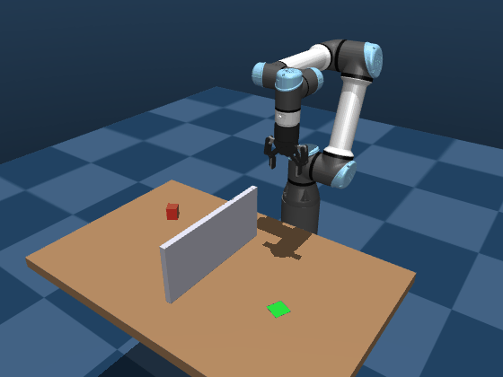

# mj-pickplace — IK, motion planning and grasping from scratch in MuJoCo

A UR5e with a Robotiq 2F-85 picks a box from one side of a divider and places it on a
target on the other side. Everything between the simulator and the result is written
from scratch and verified against ground truth:

- product-of-exponentials kinematics,
- damped-least-squares IK,
- RRT-Connect with collision guarantees,
- shortcutting and time parameterisation,
- grasp synthesis,
- a 7-state pick-and-place machine,
- an evaluation harness with explicit quality metrics.



*(2x speed. Full-resolution, real-time video: [`media/pick_place.mp4`](media/pick_place.mp4).)*

## Headline results (all measured, all reproducible with the commands below)

| What | Result |
|---|---|
| End-to-end pick-and-place, perfect perception | **200/200 success** (95% CI 98.1–100%), placement error median **0.2 mm** / p95 0.5 mm |
| Same, with 5 mm / 5° pose-estimate noise | 200/200, median 0.3 mm / p95 0.7 mm |
| Stress: 12 mm / 10° noise | 86.5% (95% CI 81.1–90.6%); all failures are grasp-stage |
| Ablation: no in-hand re-measurement (5 mm noise) | placement error **12× worse** (median 3.5 mm, p95 11.1 mm) |
| Ablation: no tracking feedforward | max tracking error **0.212 rad** vs 0.002 rad |
| FK / Jacobian vs MuJoCo | agree to < 1e-10 (tested on 200 random configurations) |
| IK on 1000 random reachable poses | **98.9%** success, median 3.3 ms, errors below 0.1 mm / 0.03° |
| RRT-Connect, 100 queries across the divider | 100/100 solved; **0 collisions** when every trajectory is re-checked at zero margin, 5 ms resolution |
| vs OMPL RRTConnect (same checker, 50 queries) | similar planning time (58 vs 47 ms median); **16% shorter** final paths (2.31 vs 2.75 rad) |

## Quick start

```bash
bash scripts/fetch_assets.sh          # UR5e + 2F-85 from MuJoCo Menagerie (pinned commit)
pip install -e ".[dev,media]"
pytest                                # 36 tests, ~12 s
python -m pnp.eval.run_eval --n 200 --configs nominal noisy noisy_large noisy_no_inhand no_feedforward
python scripts/bench_ik.py --n 1000
python scripts/bench_planner.py --n 100
pip install ompl && python scripts/compare_ompl.py --n 50     # optional
MUJOCO_GL=egl python scripts/record.py --seed 3 --out media/pick_place.gif
```

Docker (headless, includes EGL for rendering):

```bash
docker build -t pnp . && docker run --rm pnp                       # runs the test suite
docker run --rm -v $PWD/results:/app/results pnp python -m pnp.eval.run_eval --n 200
```

CI (`.github/workflows/ci.yml`) runs four jobs:

- ruff,
- the full pytest suite on Python 3.11 and 3.12,
- a 10-episode smoke benchmark (uploaded as an artifact),
- the test suite again inside the Docker image.

## Architecture

```
pnp/
  se3.py               SO(3)/SE(3): exp/log (robust near pi), adjoint, quaternions
  sim/scene.py         MjSpec scene: UR5e + 2F-85, table, divider, box, target; all constants
  sim/collision.py     CollisionChecker: private model, clearance margin, swept-volume edge checks
  ik/kinematics.py     PoE FK + geometric Jacobian, screw axes extracted from the MuJoCo model
  ik/solver.py         Damped-least-squares IK
  planning/rrt_connect.py   RRT-Connect in joint space
  planning/postprocess.py   randomised continuous shortcutting + pruning
  planning/timing.py        path-preserving trapezoidal / quintic time parameterisation
  planning/planner.py       plan = RRT-Connect -> shortcut -> timing; dense validation
  control/cartesian.py straight-line Cartesian moves (IK per sample, branch-jump detection)
  control/grasp.py     grasp candidates, pad-contact sensing
  control/executor.py  trajectory tracking with feedforward, physics contact monitor
  control/pipeline.py  the state machine
  eval/metrics.py      metric definitions + success judgement from physical state
  eval/run_eval.py     randomised paired benchmark, Wilson CIs, markdown/JSON output
scripts/               benchmarks, OMPL comparison, rendering, asset fetch
tests/                 36 tests against analytic answers and MuJoCo ground truth
```

**Key decision: a hybrid motion strategy.** RRT-Connect handles only the free-space moves:

- home → pre-grasp,
- lift → pre-place,
- retreat → home.

The near-contact moves are *Cartesian straight lines solved by IK*:

- pre-grasp → grasp,
- lift,
- place descent,
- retreat.

A sampling planner gives no control over TCP geometry near the object. Production pick
cells use straight-line approach and depart moves for the same reason.

## Components and design choices

### Kinematics (`ik/kinematics.py`)

**How it is built.** FK and the geometric Jacobian are implemented with the
product of exponentials:

- `T(q) = e^[S1]q1 … e^[S6]q6 M`
- `J_s,i = Ad(e^[S1]q1…e^[Si-1]qi-1) S_i`, then converted to the velocity of the TCP point.

The screw axes and the home pose `M` are *read from the compiled MuJoCo model at q = 0*
(joint axes and anchors). There is no hand-typed DH table to get wrong. After
extraction, FK is pure numpy and never touches `MjData`, so the MuJoCo comparison in
the tests is an independent check.

**Verification.** FK and the Jacobian are compared with `mj_kinematics` and
`mj_jacSite` on random configurations and agree to < 1e-10. The Jacobian also matches
finite differences, and FK is checked to be 2π-periodic.

### Inverse kinematics (`ik/solver.py`)

The update is `dq = Jᵀ(JJᵀ + λ²I)⁻¹e`, with three design choices:

- **Orientation error via the SO(3) log map** (`log(R_d Rᵀ)`), which is a true geodesic
  with no Euler-angle singularities. The log is made robust at θ ≈ π, which comes up
  with top-down grasps.
- **Two-term damping, `λ² = λ_s² + β‖e‖²`.**
  - `λ_s` ramps up only when σ_min(J) drops below a threshold, which bounds joint steps
    near wrist, elbow and shoulder singularities.
  - The `β‖e‖²` term (Sugihara 2011) vanishes at the solution, so the final iterations
    are undamped Gauss-Newton and converge quadratically.
  - My first trigger was manipulability `√det(JJᵀ)`. Its units mix metres and radians,
    so it was active in >50% of random configurations and made convergence linear.
- **Joint limits.** A 6-DoF arm has no null space to steer away from limits, so limits
  are enforced by projection:
  - Joints whose range spans a full turn are *wrapped*. This is exact, because revolute
    FK is 2π-periodic.
  - Other joints are clipped.
  - Stalled descents are abandoned and restarted from random seeds.
  - The seeded attempt always runs first, so Cartesian moves stay on one IK branch.

An optional `validator` (a collision check) makes "IK succeeded" mean "IK found a
*usable* solution".

| Variant (1000 random reachable poses, random seeds) | Success | Pos err med / max (mm) | Rot err med / max (deg) | Iters med / p95 | Time med / p95 (ms) |
|---|---|---|---|---|---|
| DLS, single descent (no restarts) | 84.6% | 0.0093 / 0.1000 | 0.00004 / 0.0228 | 18 / 134 | 3.3 / 24.2 |
| **DLS + up to 20 random restarts** | **98.9%** | 0.0107 / 0.1000 | 0.00003 / 0.0344 | 18 / 203 | 3.3 / 38.2 |
| Ablation: clip all joints instead of wrapping, 20 restarts | 96.4% | 0.0123 / 0.1000 | 0.00007 / 0.0516 | 78 / 627 | 14.0 / 112.9 |

Notes on the table:

- The convergence tolerance is 0.1 mm / 0.057°, so the maximum error equals the
  tolerance by construction.
- The 1.1% of failures stall in slow convergence next to singular targets, ending at
  0.1–0.3 mm error.
- Wrapping instead of clipping makes the solver 4× faster at the median and removes
  most limit-stall failures.

### Collision checking (`sim/collision.py`)

The checker owns a *private* model and `MjData`, so planning never perturbs the live
simulation. Each query writes `q` (and the held object's pose, when one is attached),
runs `mj_kinematics` + `mj_collision`, and classifies the contacts it finds.

**Clearance.** Any contact with `dist < margin` (1 cm) counts as a collision. Two
MuJoCo details had to be handled explicitly:

- **Margins must be set before compiling.** A unit test (`test_margin_is_exact`) caught
  that setting `geom_margin` on an *already-compiled* model silently misses contacts:
  MuJoCo's mid-phase BVH is built at compile time, and the finger pads were never
  reported. The checker therefore compiles its own copy with the margin set in the
  `MjSpec`.
- **Margins add.** MuJoCo sums the two geoms' margins, so the checker filters on `dist`
  explicitly to get exactly a 1 cm clearance.

**Edge checking with a guarantee.** Edges are not checked at a fixed joint step.
Instead they use a swept-displacement bound (Schwarzer et al. 2004):

- No robot point moves more than `Σ rᵢ|Δqᵢ|`, where `rᵢ` bounds the distance from joint
  i to any distal collision geometry. The bounds come from link offsets and geom
  bounding radii, and are enlarged by the held object when one is attached.
- Sampling so that this sum is ≤ the margin per step means a segment that is free at
  the samples is free in continuum.
- Samples are visited coarse-to-fine, so collisions in the middle of an edge are found
  early.
- The bound itself is unit-tested against FK on 500 random motions.

**Allowed-collision entry.** The shoulder link rotates 3 mm above its pedestal, which is
always inside the margin. That single pair is whitelisted, as in a MoveIt SRDF.

### Motion planning (`planning/`)

**RRT-Connect** (Kuffner & LaValle 2000):

- Bidirectional trees; extend one tree a step, then greedily connect the other; swap
  roles every iteration.
- Nearest-neighbour search is a vectorised linear scan. At these tree sizes (10²–10³
  nodes) that beats a KD-tree, which would need rebuilding as the tree grows.
- The distance is a *weighted* joint metric (proximal joints weigh more), so "nearest"
  approximates "least swept volume".

**Shortcutting:**

- Pick two random points on the *continuous* arc length, not just at vertices, so
  shortcuts can cut corners mid-edge.
- Then prune greedily to the farthest visible vertex.

**Time parameterisation is path-preserving:**

- Each straight segment is timed with one scalar profile `s(t)` shared by all joints, so
  the executed trajectory traces exactly the segments that were collision-checked.
  Timing can never introduce a collision.
- Per-segment scalar limits are `v_s = minᵢ vᵢ/|Δqᵢ|` and `a_s = minᵢ aᵢ/|Δqᵢ|`.
- Trapezoid profile: time-optimal for these limits.
- Quintic profile: C², with duration `T = max(15/8 / v_s, √(10/√3 / a_s))`.
- The cost is a stop at each interior vertex, of which there are typically about 3
  after shortcutting.

| Profile (100 queries, pick zone → place zone, across the divider) | Solved | Plan time med / p95 (ms) | Path length raw → shortcut (rad) | Vertices | Duration (s) | Collisions (0-margin re-check, 5 ms) | Max v/v_lim, a/a_lim |
|---|---|---|---|---|---|---|---|
| trapezoid | 100/100 | 297 / 493 | 4.70 → 2.33 | 5 | 3.05 | 0 | 1.000, 1.000 |
| quintic | 100/100 | 286 / 488 | 4.70 → 2.33 | 5 | 3.62 | 0 | 1.000, 1.000 |

Velocity and acceleration ratios of exactly 1.000 mean the profiles saturate the limits
without exceeding them. Shortcutting halves the path length, and the quintic profile
costs 19% more time than the trapezoid.

**OMPL comparison** (`scripts/compare_ompl.py`). Both planners share the same validity
checker and swept-volume motion validator, so only the algorithm and post-processing
differ:

| Planner (50 queries) | Solved | RRT time med / p95 (ms) | Post-proc med (ms) | Raw length (rad) | Final length (rad) | Collision checks | Dense re-check clean |
|---|---|---|---|---|---|---|---|
| ours (RRT-Connect + shortcut) | 50/50 | 58 / 101 | 254 | 4.97 | **2.31** | 5922 | 50/50 |
| OMPL 2.0.1 (RRTConnect + simplifySolution) | 50/50 | 47 / 92 | 356 | 4.53 | 2.75 | 7694 | 50/50 |

Both are dominated by Python collision-check callbacks, so their planning times are
close. My continuous-arc-length shortcutting yields 16% shorter paths with fewer checks.
OMPL's simplifier is more general: it also smooths with B-splines, which this
comparison doesn't reward.

### Grasping and the state machine (`control/`)

**Grasp candidates.** The fingers close along the TCP y-axis (measured from the model:
open pads at ±46.6 mm). A box with a square cross-section can be pinched across either
pair of faces, and the gripper is symmetric under a half turn, so there are 4 top-down
yaw candidates. Each candidate gets a collision-validated IK solution at the pre-grasp
pose and a seeded solution at the grasp pose. Feasible candidates are ranked by weighted
joint distance, which avoids needless wrist-3 half-turns.

**Cartesian moves** (`control/cartesian.py`):

- Trapezoidal profile on the arc parameter, with linear and angular limits.
- SE(3) interpolation via `R₀ exp(s·log(R₀ᵀR₁))`.
- IK per 10 ms sample, seeded from the previous sample with no restarts.
- A joint jump > 0.05 rad fails the move as a branch flip.
- Every sample is collision checked, with contacts relaxed only for the contact class
  that phase intends (gripper↔object while descending, object↔table while lifting or
  placing).

**State machine:**

```
APPROACH ─▶ PRE_GRASP ─▶ GRASP ─▶ LIFT ─▶ TRANSPORT ─▶ PLACE ─▶ RETREAT ─▶ DONE
 (RRT)      (Cartesian)  (close)  (Cart.)  (RRT, held)  (Cart.+open) (Cart.+RRT)
```

- Every state either advances or ends the episode with a named failure,
  `FAIL_<STATE>_<reason>`.
- **Grasp check:** both left and right pads must be in contact with the object.
- **Lift check:** the object must rise at least 12 cm with both pads still in contact.
- **In-hand re-measurement:** after the lift, the object's in-hand pose is measured
  again. The place pose is computed from it as
  `T_tcp,place = T_obj,target · T_tcp,obj⁻¹`, which absorbs grasp slip and
  pose-estimate error. The ablation shows this is worth 12× in placement error.

**Execution** (`control/executor.py`):

- *Problem.* The Menagerie UR5e actuators are position servos with damping
  (kp = 2000, kd = 400). Streaming `ctrl = q_des` lags by `kd·q̇/kp` ≈ 0.24 rad at
  1.2 rad/s.
- *First fix, which failed.* Injecting feedforward torque through `qfrc_applied` went
  unstable, because the actuator's damping saturates at its ±150 Nm force range while
  the external torque does not.
- *Final fix.* Shift the setpoint instead: `ctrl = q_des + (kd·q̇_des + M q̈_des)/kp`.
  This keeps every torque inside the actuator's limits and cuts tracking error from
  0.212 to 0.002 rad.
- A physics-level contact monitor counts any robot-environment or held-object-environment
  contact during execution. It was 0 in all 1000 evaluated episodes.

## Pick-and-place quality metrics (`eval/metrics.py`)

All metrics are measured from the **physical simulation state after release, retreat
and a 0.5 s settle**, never from the plan.

| Metric | Definition |
|---|---|
| **Success** | Pipeline completed **and** placement error ≤ 15 mm **and** yaw error ≤ 10° **and** tilt ≤ 5° **and** gripper not touching the object **and** object at rest (< 1 cm/s) |
| Placement error | ‖p_obj,xy − p_target,xy‖ (mm) |
| Yaw error | rotation about z between object and target, modulo the box's 90° symmetry (deg, ∈ [0, 45]) |
| Tilt | angle between the object z-axis and world z |
| Grasp success | object lifted ≥ 12 cm with both pads in contact |
| Planning time | wall clock for IK, grasp synthesis, RRT-Connect, shortcutting, Cartesian planning (single-threaded Python) |
| Path length | executed joint-space length (Σ‖Δq‖, rad) and TCP length (m) |
| IK failures | IK queries that returned no converged, collision-free solution (including rejected grasp candidates) |
| Cycle time | simulated seconds from start to end of retreat |
| Tracking error | max ‖q − q_des‖∞ during arm motions |
| Unplanned contact | physics steps with robot–environment or held-object–environment contact |
| Failure label | `FAIL_<STATE>_<reason>` or `PLACE_TOL_<xy/yaw/tilt/…>` |

The success rate is reported with a Wilson 95% confidence interval. Episodes are seeded,
so every configuration sees identical object and target poses and the comparisons are
paired.

## End-to-end results (`results/summary.md`, 200 episodes per configuration)

The object pose is uniform over the pick zone (25 × 24 cm, any yaw); the target pose is
uniform over the place zone (25 × 24 cm, any yaw); a 20 cm divider separates the two.

| Config | Success [95% CI] | Grasp | Place err med / p95 (mm) | Yaw err med / p95 (deg) | Plan time med / p95 (s) | Joint path (rad) | TCP path (m) | Cycle (s) | IK fails | Track err (rad) | Unplanned contact |
|---|---|---|---|---|---|---|---|---|---|---|---|
| nominal | 100.0% [98.1, 100.0] | 100.0% | 0.2 / 0.5 | 0.3 / 0.3 | 0.82 / 1.21 | 5.10 | 1.88 | 11.9 | 0 | 0.002 | 0 |
| noisy (σ 5 mm, 5°) | 100.0% [98.1, 100.0] | 100.0% | 0.3 / 0.7 | 0.4 / 1.1 | 0.75 / 1.16 | 5.07 | 1.89 | 11.9 | 0 | 0.002 | 0 |
| noisy_large (σ 12 mm, 10°) | 86.5% [81.1, 90.6] | 87.0% | 0.4 / 0.8 | 0.3 / 1.6 | 0.72 / 1.18 | 5.08 | 1.88 | 11.9 | 0 | 0.002 | 0 |
| noisy, **no in-hand re-measure** | 100.0% [98.1, 100.0] | 100.0% | **3.5 / 11.1** | 0.5 / 4.4 | 0.79 / 1.23 | 5.05 | 1.89 | 11.9 | 0 | 0.002 | 0 |
| **no feedforward** | 100.0% [98.1, 100.0] | 100.0% | 0.4 / 0.7 | 0.4 / 0.5 | 0.78 / 1.16 | 5.11 | 1.89 | 12.0 | 0 | **0.212** | 0 |

Failure breakdown for `noisy_large`:

- 17 × `FAIL_LIFT_dropped`: the grasp closed with both pads in contact, but the box was
  not held through the lift.
- 9 × `FAIL_GRASP_no_pad_contact`: after closing, at least one pad was not touching the box.
- 1 × `FAIL_PLACE_collision`: the Cartesian place descent was rejected by the collision
  checker.

The noise σ there is comparable to the 22 mm per-side jaw clearance. No other
configuration had any failure.

How to read the ablations:

- **In-hand re-measurement.** The perception error is carried straight into the
  placement: p95 placement error is 11.1 mm without it, versus 0.7 mm with it. That
  sits just inside the 15 mm tolerance, so the success rate hides the effect while the
  error metric exposes it — which is why both are reported.
- **No feedforward.** The 0.21 rad servo lag did *not* cause collisions. A pure servo
  lag is mostly *along* the path (a time delay), not across it, and the 1 cm clearance
  absorbs the remaining cross-track error. It still costs placement accuracy (0.4 vs
  0.2 mm median), and a planner whose guarantees silently depend on the servo lag staying
  along-path is fragile.

## Honest limitations

- **Perception is simulated.** The object pose comes from the simulator plus Gaussian
  noise, and the in-hand re-measurement uses the true state, standing in for a wrist
  camera. There is no vision pipeline.
- **One object class.** All tests use a single 4 × 4 × 5 cm box with known geometry and
  top-down grasps only; there is no grasp-quality metric (e.g. force closure) beyond
  pad contact.
- **Nominal success is easy by design.** With perfect state, the clutter-free task
  saturates at 100%. The noise and ablation configurations are what discriminate.
- **Stops at waypoints.** The path-preserving time parameterisation stops at each
  interior vertex (about 3 per free move). Time-optimal path tracking (e.g. TOPP-RA)
  with collision re-validation would cut cycle time.
- **Planning speed.** Planning is single-threaded Python, roughly 0.3 s per free move,
  dominated by about 6k MuJoCo collision queries issued one at a time from Python. A C++
  checker or batched queries would be the first optimisation.
- **Swept-volume bound scope.** The bound covers the arm and the held object. Gripper
  finger motion during open and close is not swept-checked; those happen only in
  Cartesian phases with explicit contact relaxations.

## References

- Lynch & Park, *Modern Robotics* (2017) — PoE kinematics, adjoints, exp/log maps.
- Kuffner & LaValle, *RRT-Connect* (ICRA 2000).
- Sugihara, *Solvability-unconcerned inverse kinematics by the Levenberg–Marquardt method* (T-RO 2011).
- Nakamura & Hanafusa (1986); Maciejewski & Klein (1988) — damped least squares near singularities.
- Schwarzer, Saha & Latombe, *Exact collision checking of robot paths* (2004) — swept-displacement bounds.
- Geraerts & Overmars, *Creating high-quality paths for motion planning* (IJRR 2007) — shortcutting.
- Robot models: [MuJoCo Menagerie](https://github.com/google-deepmind/mujoco_menagerie) (UR5e: ROS-Industrial BSD; 2F-85: BSD).
